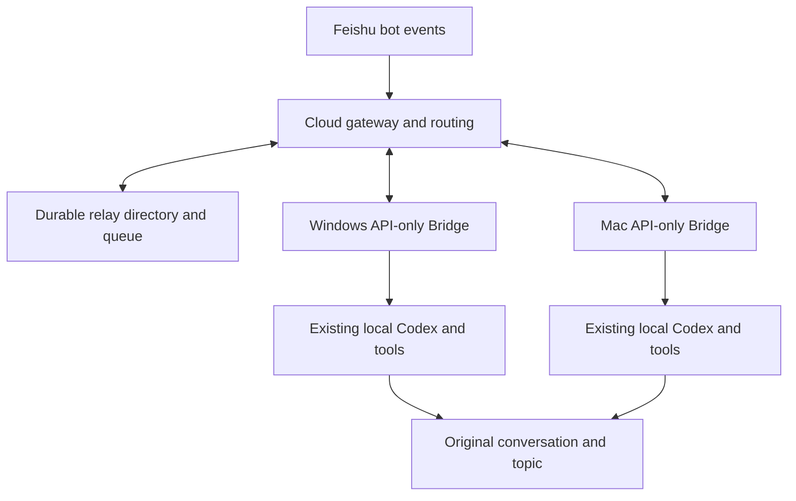

# Realtime relay implementation contract

Status: engineering contract for the new opt-in relay mode. The deployed Bitable mode remains unchanged until staged cloud and worker acceptance complete.

## Verified constraints and chosen responsibilities

Current Bitable directory reads took about 1–4 seconds in live probes, and cross-host delivery can wait for a configured 60-second poll. Feishu delivers an event to one of an application's connected clients, so multiple independent receivers do not provide deterministic device routing. The new mode therefore has one cloud Feishu receiver and persistent outbound worker connections. The cloud never invokes Codex, a model provider, a shell task, a project tool or an execution handler.



The gateway needs the existing Feishu App ID/App Secret and owner/admin IDs. Codex logins, model credentials, local projects, session files and inbox receipts stay on each computer. A separate high-entropy relay token authenticates worker connections; it is never the App Secret and never appears in URLs, argv, logs or Git. WSS provides public-network transport protection. Plain WS is allowed only on loopback, for tests or an explicitly managed encrypted SSH tunnel.

## Modes and compatibility

Extend `FleetConfig` with `transport?: 'bitable' | 'relay'` and `relay?: { url: string; tokenSecretId: string; proxyUrl?: string }`. Absent transport retains Bitable behavior. Keep legacy appToken/tables fields for compatibility and rollback, but relay validation does not require usable Bitable identifiers; a relay-only setup may leave those legacy strings empty. `apiProxyUrl` stays scoped to Bitable; optional `relay.proxyUrl` scopes only the relay socket.

Extend `FleetNode` with optional `kind: 'worker' | 'gateway'`. Existing nodes without kind remain workers. Gateway nodes are registered for signed command-source verification but are never selectable or executable. The signed row format, app scope, FLEET_PROTOCOL=1, event hashes, command TTL, durable inbox, original IDs and card proofs stay unchanged.

Worker mode constructs the existing orchestrator/HTTP sender but opens no Feishu event WebSocket. Only the gateway opens that receiver. Workers dispatch forwarded events through the original onMessage/cardAction/reaction/comment/botAdded/botRemoved/botMenu handlers and preserve every original field, thread ID, operation value and render token. Local account, project, user and group checks still run at the destination.

`FleetRuntime.start(beforeConsume?)` provides the activation window after home/migration/publication/project validation and before the first drain. The retained callback also runs after reconnect publication/sync. Workers select caller-managed activation so a replacement socket remains inactive until this callback succeeds; direct clients restore only previously acknowledged activation. Disabled relay configurations fail closed instead of opening a local Feishu receiver.

## Shared storage hooks

Preserve existing FleetStorage methods. Add optional hooks:

```ts
type FleetStorageNotice = { type: 'commands'; target: string }
  | { type: 'presence' } | { type: 'reconnected' };
connect?(): Promise<void>;
subscribe?(listener: (notice: FleetStorageNotice) => void): () => void;
isNodeConnected?(nodeId: string): boolean;
compareAndSwap?(table: FleetTable, row: StoredValue,
  expectedValue: string | null): Promise<boolean>;
close?(): Promise<void>;
```

Add `SignedFleetStore.putIfUnchanged(table, key, previousValue, nextValue, target?, expiresAt?)`. It deterministically encodes the observed previous signed value and uses storage CAS; legacy stores retain the previous non-atomic put behavior. Route binding, project sync and first-home initialization use the observed value so concurrent ownership claims cannot overwrite each other. A failed first-home CAS may reread and accept an already initialized valid home; no blind owner replacement.

Relay notices wake command consumption immediately and retain a pending wake across an in-flight tick. Heartbeat/presence processing must not wait for model work or a slow handler. Relay mode tracks active command IDs and a bounded set of dispatch promises, skips active IDs when draining more pending commands, and prevents an accepted receipt from being removed/replayed by another scheduling pass. Maintain per-chat ordering and bounded shutdown draining. Bitable scheduling semantics remain compatible. Worker heartbeats are lightweight relay operations every 15 seconds, not Bitable API calls. After reconnect, republish/sync and drain pending commands. Known disconnected targets are unavailable immediately; do not wait for signed heartbeat expiry to show offline. The picker receives a computed offline view after signature verification, without rewriting stored signed bodies.

Runtime stop unsubscribes and stops intake. Runtime shutdown drains accepted control work with a bound and publishes offline. Storage ownership belongs to the caller: worker bridge closes its relay storage after runtime shutdown; gateway shutdown does not close the server-owned store. Network loss never switches transport or replays unacknowledged mutation RPCs or tasks.

## Wire protocol v1

WebSocket endpoint `/relay/v1`; HTTP upgrade requires `Authorization: Bearer <relay token>`. No token query parameters. The server is configured for one App ID. Non-loopback public access is behind a TLS reverse proxy; server default bind is 127.0.0.1:8787.

1. Client hello: `{ type:'hello', version:1, appId, role:'worker', nodeId, host }`, or `{ type:'hello', version:1, appId, role:'observer' }`. nodeId/host match the existing stable identity and host digest. Authentication/hello deadline 5 seconds.
2. Server ready: `{ type:'ready', version:1, nodes:string[] }`, listing active worker IDs only.
3. RPC request: `{ type:'request', id, op, table?, key?, row?, target?, cursor?, expectedValue? }`. Ops: get/list/put/remove/cas/activate. An observer can only get/list. `activate` has no table and marks a prepared worker ready to execute. Setup clients never activate; the bridge activates after migration/publication/startup completes. Reconnect restores requested activation. Different-host duplicate identity is rejected without displacing its owner; same-host reconnect can replace an old socket safely.
4. RPC response: `{ type:'response', id, ok:true, result }`, or `{ type:'response', id, ok:false, error:{ code,message } }`. get returns row/null; list returns `{ items:StoredValue[], cursor?:string }`; put/remove/activate return null; CAS returns boolean and requires expectedValue (null means absent).
5. Push: `{ type:'notice', kind:'commands', target }` only to the target active worker, and `{ type:'notice', kind:'presence', nodes:string[] }` to authenticated peers. Commit before acknowledgement and notice. Notify pending work when a worker activates/reconnects.

Use per-attempt timeouts, correlation IDs, bounded pending RPCs and send buffers, server ping/pong, and bounded reconnect backoff. Initial worker connection can remain pending/reconnecting so a temporary cloud outage at login does not kill the Windows daemon; explicit auth/version/identity failures are terminal and surfaced. Observers and setup calls have bounded one-shot connection timeouts. A socket close rejects in-flight mutations as unknown, with no automatic resend. No whole-event retry.

Limits: 256 KiB frame; 128 KiB row value; 256-character key; 32 worker connections plus a bounded observer pool; 16 MiB persistent data budget; 10000 rows per table. List responses paginate by byte budget (128 KiB target) and count (at most 100) with a bounded cursor. All input is shape/size validated. Disable compression, cap buffered sends and reject overload. No request payload, message content, secret, credential header or URL token is logged.

## Server API, persistence and gateway

Export `startFleetRelayServer({ appId, token, dataDir, host?, port? })`. Its handle exposes `url`, `storage: FleetStorage`, `setGatewayState('disabled'|'connecting'|'connected'|'error')` and `close()`. Local store presence queries use the active worker map. It supports single-writer locking, validated state, atomic fsynced snapshot replacement, serialized mutations/CAS, TTL cleanup for expired commands and fail-closed corruption handling. Restart retains metadata and pending commands. Store keys are data, never filesystem paths. GET /healthz returns bounded health/version/gateway state only.

Export `startFleetRelayGateway({ appId, appSecret, tenant, ownerOpenId, admins?, storage, dataDir, onError?, onState?, channel? })`. Optional injected channel supports tests. Reuse createLarkChannel options/raw taps from the native bridge and `createFleetPicker`; no orchestrator/backend imports. Its deterministic gateway node is non-executable and filtered from picker results. Gateway runtime may start without a home route so an empty staged service can later accept initialization; unbound/offline messages receive a clear response. Destination permissions remain authoritative. Callbacks acknowledge immediately. A gateway self-target can never execute; dispatch rejects by construction. Only enabled production gateway connects Feishu.

Build portable `dist/relay-server.cjs` using the existing toolchain and bundle runtime dependencies so the cloud needs only Node 24, not npm install/build/model tooling. Preserve six private build guards. CLI supports --help without credentials, `--storage-only` staging, and protected credential files/environment paths. Production config names: CODEX_RELAY_APP_ID, CODEX_RELAY_TOKEN_FILE, CODEX_RELAY_APP_SECRET_FILE, CODEX_RELAY_OWNER_OPEN_ID, CODEX_RELAY_TENANT, CODEX_RELAY_GATEWAY_ENABLED, CODEX_RELAY_HOST, CODEX_RELAY_PORT, CODEX_RELAY_DATA_DIR. Never accept raw secrets in argv. Defaults are loopback and gateway enabled only when production credentials are present; incomplete production config fails explicitly.

## Worker setup and staged migration

`fleet relay setup --url <wss-url> [--name <name>] [--app-id <id>] --token-stdin [--proxy-url <local-proxy>] [--import-from-bitable]` reuses existing bot credentials, node ID, inbox and local state. Relay token goes into the native encrypted keystore, referenced by tokenSecretId. Existing native/background and foreground single-instance locks must prevent setup while the bot is running. Preserve stable identity on interrupted setup; a pending identity file may be used, with atomic final config commit. Failed migration restores the prior usable config rather than enabling an incomplete mode. Preserve the previous token on failed same-endpoint reconfiguration.

Explicit Bitable import verifies signatures, copies only nodes/routes and refuses conflicting existing values. It never imports command queues or inbox receipts. Gateway metadata is not an import conflict. Keep old Bitable references for rollback; never dual-write or silently fall back. First setup can initialize absent home atomically. CLI status shows the selected transport/URL, never token values. A diagnostic observer must not replace a running worker.

Deployment order: inspect the selected server; back up existing configuration; stage storage/WebSocket server with gateway disabled behind validated TLS; prepare updated workers and confirm old Mac receiver stopped; stop Windows old receiver, import metadata and start API-only relay worker; enable the cloud gateway; verify fresh worker heartbeats, event delivery and old session/card ownership; then join Mac in API-only mode. Keep a rollback path that stops the new gateway before restoring old receiver mode. No existing live mode is changed while the cloud target/access is missing.

## Acceptance

Server: auth/namespace/hello/observer/limits, presence and duplicate identity, durable CRUD/CAS/pagination/expiry/restart/corruption/locking, immediate notifications, buffer/disconnect handling, gateway routing of all seven event kinds with a fake channel and zero execution/model calls, native standalone bundle smoke.

Worker: URL/token storage/transaction/legacy validation, API-only receiver (zero local Feishu connect calls), real socket RPC/notice/reconnect/activation/timeout/unknown mutation, host identity, per-chat ordering, slow handler does not stop heartbeat or unrelated delivery, shutdown/no replay, read-only observers, signed metadata import/conflicts/no commands, original permissions/card/session tests.

Integration: independent processes with the real relay, delivery without waiting for a 60-second maintenance interval, server restart, target restart with durable inbox, no duplicate task after ambiguous delivery, original reply/thread/callback fields. Full tests/typecheck/build/extensions/native CLI checks and three-platform CI precede activation. Actual cloud and Windows+Mac acceptance remain distinct from local tests.

Primary references: [Feishu long-connection event delivery](https://open.feishu.cn/document/ukTMukTMukTM/uYDNxYjL2QTM24iN0EjN/event-subscription-configure-), [ws project](https://github.com/websockets/ws), [Caddy reverse proxy](https://caddyserver.com/docs/caddyfile/directives/reverse_proxy).
